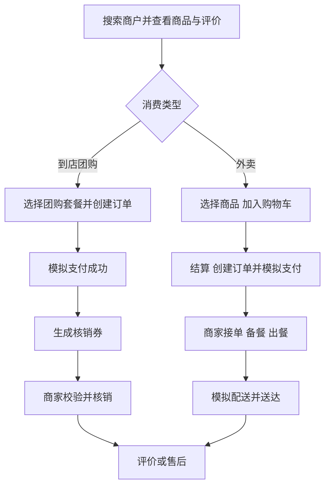
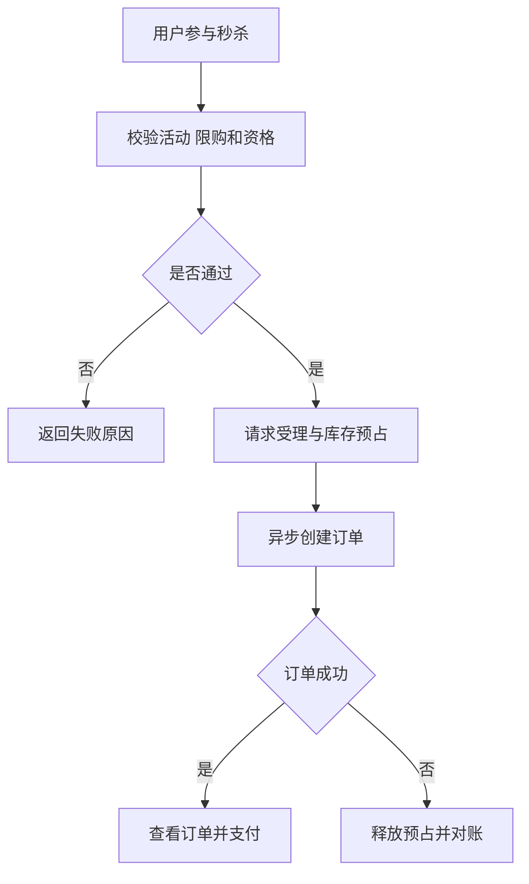

# NexusOps：智慧商圈交易平台｜项目需求规格说明

> 文档版本：重构版 v2.0  ·  文档定位：**为什么做、谁来用、做什么、有哪些业务约束**  
> 关联文档：[系统架构与技术设计](02_系统架构与技术设计.md) · [开发计划与测试验收](03_开发计划与测试验收.md)

## 1. 项目概述

### 1.1 背景与定位

本地餐饮及零售商圈存在商户发现、评价、优惠团购、购买和外卖履约等连续消费需求。商家需要统一管理商品、库存、营销、订单及经营数据；平台需要开展商户治理与运营。峰值抢购、重复支付回调、订单并发状态变化等情况要求系统具备可靠的交易控制；知识检索和智能运营则需要严格的权限及执行审计。

**NexusOps 是集本地商户点评、优惠团购及秒杀、外卖订单交易、商家经营管理、AI 智能服务于一体的智慧商圈交易平台。** 借鉴黑马点评的商户/营销场景与苍穹外卖的交易履约场景，但不是复制或拼装现有教学仓库。智能能力采用 RAG、**纯手写 Python Agent Harness**、受控 Agent RSI。

### 1.2 产品目标

| 目标 | 业务结果 |
|---|---|
| 消费者闭环 | 发现商户→点评/选购→团购或外卖交易→核销/配送→评价售后 |
| 商家闭环 | 商品与库存→活动配置→接单/核销→售后→经营分析 |
| 平台闭环 | 商户准入→规则治理→营销运营→交易异常处理与审计 |
| AI 业务闭环 | 知识问答/经营分析→生成建议或操作草稿→授权审批→执行与反馈 |
| 迭代闭环 | Agent 执行反馈→改进候选→离线评测→审批发布→监测回滚 |

### 1.3 范围与非目标

- **必须覆盖**：商户与商品、基础评价、团购券及核销、优惠券秒杀、外卖订单与模拟履约、售后入口、商家和平台管理；后续增加 RAG、Harness 与 RSI。
- **本期不做**：真实支付/退款资金结算、真实骑手运力与路径调度、酒店旅行、完整社交 Feed、复杂多商户拆单结算、Kubernetes 微服务平台。
- 高风险业务写入和 RSI 策略上线需要服务端授权与必要的独立审批；AI 输出不是执行授权。

## 2. 角色与权限

### 2.1 基础业务角色

| 角色 | 核心职责 | 数据范围 |
|---|---|---|
| 消费者 | 搜索商户、收藏、团购、下单、查看订单、评价及售后 | 本人账户及交易 |
| 商家员工 | 外卖接单/备餐/出餐、团购核销、售后协助 | 所属商户授权订单 |
| 商家管理员 | 店铺、商品、库存、活动、员工、售后和经营数据 | 本商户及授权门店 |
| 平台管理员 | 商户准入、用户和平台规则、营销运营、异常监管 | 平台范围内按权限访问 |

### 2.2 特殊权限与系统身份

知识管理员、平台运营、审批/审计**不再默认作为独立基础角色**，改成可分配的权限组：`knowledge.manage`、`platform.campaign.manage`、`approval.decide`、`audit.read`、`agent.policy.manage`、`rsi.release` 等。运营工作与平台管理共享一个后台，但保留不同权限。

**Agent 服务身份**不属于人类 RBAC 角色。工具调用须同时满足服务身份权限、发起人权限、租户/对象授权与审批策略；不得审批自己的操作。

**职责分离要求**：角色精简不意味着消除控制。敏感退款、权限提权、RSI 发布等应禁止自审；必要时使用单独的审批测试账户验证。

### 2.3 关键权限矩阵（默认策略）

| 业务操作 | 消费者 | 商家员工 | 商家管理员 | 平台管理员 |
|---|---|---|---|---|
| 浏览商户/商品 | 允许 | 允许 | 允许 | 允许 |
| 本人购物车/团购/外卖下单 | 本人 | — | — | — |
| 店铺订单接单/核销 | — | 授权执行 | 允许 | 监管只读 |
| 商品、库存、商家活动维护 | — | 默认无 | 允许 | 默认监管只读 |
| 商户入驻及平台规则 | — | — | — | 授权管理 |
| 经营报表 | 本人订单 | 授权待办 | 本商户 | 授权平台范围 |
| 知识管理 | — | 可授权 | 可授权 | 可授权 |
| 高风险审批及 RSI 发布 | — | — | 单独授权 | 单独授权，禁止自审 |

> 表中“允许”仍须通过对象级授权；一个人可以有多个权限组，但敏感操作需要满足职责分离规则。

## 3. 核心业务模块

| 业务域 | 面向角色 | 核心能力 | 关键规则 |
|---|---|---|---|
| 商户点评 | 消费者/商家 | 搜索筛选、商户详情、评分评价、商家回复、收藏 | 评价基于已完成消费；评分来源可复核 |
| 优惠团购 | 消费者/商家 | 优惠券、秒杀、团购套餐、团购券、到店核销 | 券与订单分开管理；重复核销禁止 |
| 外卖交易 | 消费者/商家 | 商品规格、购物车、结算、订单、模拟支付、履约、退款 | 单商户结算；状态机及金额以服务端为准 |
| 商家经营 | 商家/平台 | 商品库存、活动、接单、售后、经营分析 | 按商户隔离与审计 |
| 平台治理 | 平台 | 入驻审核、账户/规则、活动监管、争议处理 | 高风险动作受控 |
| 知识与 AI | 授权角色 | 文档管理、RAG 检索、AI 客服、运营分析、操作草稿 | 知识 ACL、审批后写入 |
| Agent 改进 | 授权管理者 | 反馈、候选、离线评测、发布、回滚 | 候选不得直接改线上权限和规则 |

## 4. 功能需求清单

优先级：**P0 = 核心必做**；**P1 = 主线深化**；**P2 = 可选拓展**。

| 编号 | 模块 | 功能 | 优先级 | 关键验收点 |
|---|---|---|---|---|
| F00 | 商户发现与评价 | 门店搜索、详情、评分、合规评价与商家回复 | P0 | 评价与订单/权限绑定；评分计算可复核 |
| F01 | 认证与权限 | 注册/登录、JWT、Token 更新、RBAC | P0 | 未授权访问返回 401/403，租户数据隔离 |
| F02 | 商户与商品 | 商家、分类、商品、价格、上下架 | P0 | 基础 CRUD、权限、分页与查询索引 |
| F03 | 商户查询缓存 | Cache Aside、空值缓存、热点保护 | P0 | 缓存故障可降级，能比较数据库回源负载 |
| F04 | 优惠券活动 | 活动创建、限购、上下线、时间窗 | P0 | 活动状态校验可复测 |
| F05 | 秒杀下单 | 库存控制、一人一单、幂等、限流 | P0 | 并发测试中无超卖、无重复有效订单 |
| F06 | 购物车与下单 | 加购、结算、锁定价格、创建订单 | P0 | 价格与库存服务端校验 |
| F07 | 订单与外卖履约 | 模拟支付、接单/拒单、备餐、模拟配送、取消、退款模拟 | P0 | 状态机正确、重复回调安全、全过程可追踪 |
| F08 | 可靠消息 | Outbox、RabbitMQ、重试、死信 | P0 | Broker 故障可恢复，重复消费幂等 |
| F09 | 后台运营 | 商品、库存、优惠券、订单管理 | P1 | 商家组织隔离、操作审计 |
| F10 | 数据统计 | 订单、销量、活动效果、异常统计 | P1 | 统计口径明确、聚合查询正确 |
| F11 | 文档管理 | 文件上传、版本、解析状态、删除 | P0（AI 阶段） | 可定位失败原因并支持幂等重试 |
| F12 | RAG 检索 | Embedding、混合检索、Rerank、引用 | P0（AI 阶段） | 定量检索评测、来源可追溯 |
| F13 | 知识权限 | 租户过滤、文档 ACL、证据鉴权 | P0（AI 阶段） | 越权检索测试全部通过 |
| F14 | Harness 核心 | Agent Loop、消息格式、工具注册/执行 | P0（AI 阶段） | 不依赖 Agent 框架，行为可测试 |
| F15 | Harness 可靠性 | 状态持久化、Checkpoint、恢复、重试 | P0（AI 阶段） | 强制中断后可安全恢复 |
| F16 | 工具审批 | 只读/写工具分级、动作草稿、审批 | P0（AI 阶段） | 未审批不能执行高风险副作用 |
| F17 | Harness 观测 | Trace、Token、延迟、错误分类、成本 | P1 | 每次执行可追踪到工具和模型调用 |
| F18 | Agent 评测 | 固定任务集、回归评测、提示注入测试 | P1 | 能比较版本质量与失败类型 |
| F19 | 位置与社交扩展 | Redis GEO 附近商家（P1）；点赞、关注、Feed（P2） | P1/P2 | GEO 按距离过滤，社交模块不阻碍交易主线 |
| F20 | 高级平台化 | 多模型路由、熔断、沙箱代码执行 | P2 | 在明确需要且有安全隔离后实施 |
| F21 | RSI 执行反馈 | 收集 Agent 轨迹、错误分类、人工反馈、任务评测结果 | P1（第五阶段） | 样本可追溯，反馈与版本关联 |
| F22 | RSI 候选生成 | 提出 Prompt、Skill、工具选择策略、上下文策略的改进方案 | P1（第五阶段） | 候选变更有结构化差异及适用范围 |
| F23 | RSI 离线验证 | 基线对照、回归集、未见任务、成本与安全评测 | P1（第五阶段） | 质量不退化、安全门禁通过 |
| F24 | RSI 发布回滚 | 沙箱验证、人工审核、版本化发布、灰度和回滚 | P1（第五阶段） | 未经批准不修改线上执行策略 |

---
## 5. 核心业务流转

### 5.1 消费者两种交易路径

### 5.2 秒杀购买与库存结果

### 5.3 关键业务规则

| 场景 | 必须明确的约束 |
|---|---|
| 商户评价 | 同一消费凭证的评价资格和次数受限；商家可回复，不得修改消费者原文 |
| 团购券 | 购买成功后签发；过期、已核销、退款处理中等状态不得被非法核销 |
| 秒杀 | 不超卖、不突破限购；受理成功不等于成交成功；库存与订单可对账 |
| 外卖订单 | 创建→支付→接单→备餐→配送→完成；取消/退款为受控分支 |
| 支付/售后 | 模拟支付与回调；重复回调幂等；退款按券或订单状态判定 |
| 商家范围 | 商品、订单、券、经营数据均按商户和授权门店隔离 |
| AI 操作 | 默认只读；写操作生成草稿、经授权/必要审批后重新校验并执行 |

## 6. 用户界面范围

| 入口 | 必要页面/能力 | 实施安排 |
|---|---|---|
| 消费者端 | 搜索、商户/商品详情、收藏、购物车、团购、外卖订单、评价与售后 | 交易阶段建立闭环，小程序后续适配 |
| 商家后台 | 商品库存、活动、接单、核销、售后、经营报表 | 第二阶段起 |
| 平台后台 | 商户审核、运营活动、账户权限、异常监管 | 第二阶段起 |
| AI 工作台（后台模块） | 文档、检索、Agent 对话/轨迹/审批、RSI 评测与发布 | 第三至五阶段 |

> 管理入口优先共用一套 Web 应用，通过 RBAC 隔离，不提前拆成多个独立管理前端。

## 7. 需求判定与变更原则

- P0 优先保障完整业务闭环与正确性，P1 处理深度能力，P2 仅在主线验收通过后实施。
- 新增需求必须说明业务价值、影响角色、关键规则、跨模块影响、异常情况和验收方法。
- 功能实现细节与框架选型详见文档 02；压测指标及实验详见文档 03，避免在本文件重复技术方案。
