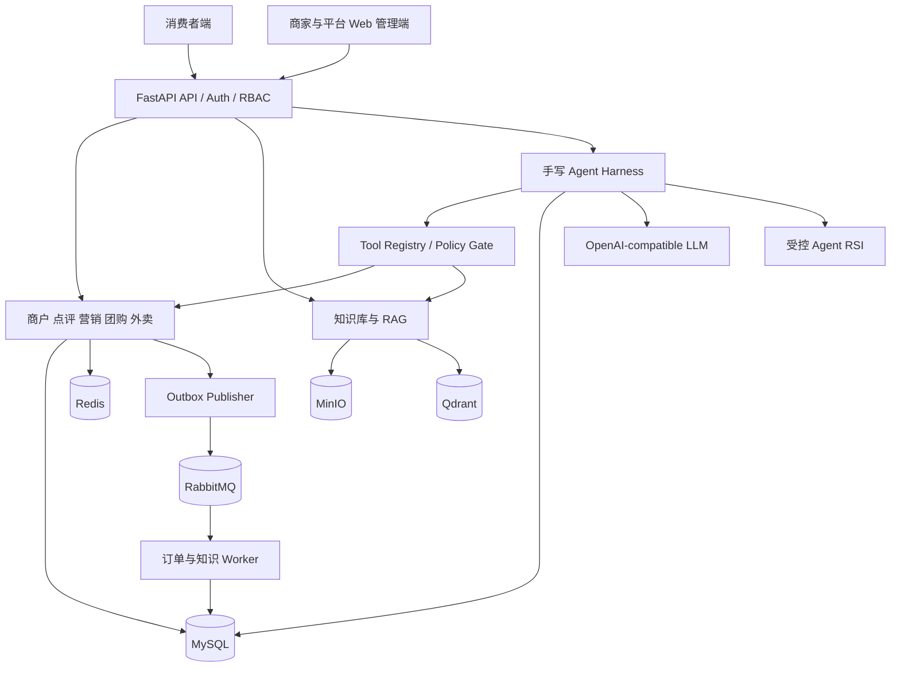
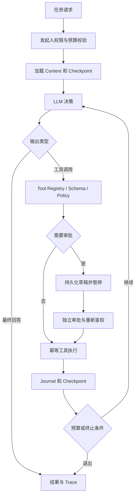
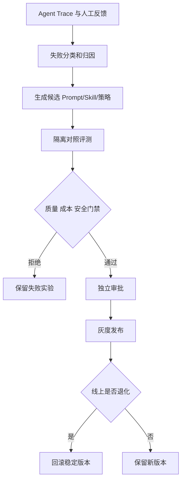

# NexusOps：智慧商圈交易平台｜系统架构与技术设计

> 文档版本：重构版 v2.0 · 文档定位：**如何实现，以及工程设计的理由与边界**  
> 上游：[项目需求规格说明](01_项目需求规格说明.md) · 验证：[开发计划与测试验收](03_开发计划与测试验收.md)

## 1. 架构原则

- 采用**模块化单体 FastAPI + 独立 Worker**，不以分布式微服务作为学习前提。
- MySQL 为订单、库存和审核状态的权威来源；Redis 用于缓存、原子预占、限流、GEO。
- 所有外部消息投递和工具调用都可能重试；业务写入使用唯一约束、幂等键、状态机、对账与补偿。
- RAG 的文档授权在检索层与最终引用阶段执行；Agent 仅通过受控工具访问业务域。
- **Harness 和 RSI 核心流程完全手写 Python**；允许 HTTP、模型 SDK、数据库、观测等通用库，但不使用 LangGraph、CrewAI、AutoGen 负责控制流。

## 2. 总体架构



### 6.2 技术选型

| 层次 | 推荐技术 | 用途与选型原因 | 是否必需 |
|---|---|---|---|
| 消费者端 | uni-app（Vue 3 + TypeScript） | 微信小程序，商户浏览、购物车、订单、AI 助手 | 阶段二起 |
| 管理端 | Vue 3 + TypeScript + Vite + Element Plus | 商家运营、平台管理、知识库与 Agent 工作台 | 阶段二起 |
| 前端基础设施 | Vue Router、Pinia、Axios、uni.request、ECharts | 路由、状态、请求、移动端调用和报表 | 按功能引入 |
| 前端工程/测试 | pnpm、ESLint、Prettier、Vitest、Playwright | 构建、规范、单测与 Web 端 E2E | 阶段二起 |
| 语言/runtime | Python 3.12+ | 统一后端与 Agent 技术栈 | 必需 |
| Web API | FastAPI、Pydantic v2、Uvicorn | 异步接口、Schema 验证、OpenAPI | 必需 |
| ORM/迁移 | SQLAlchemy 2.x、Alembic | 事务管理、数据库模型与版本迁移 | 必需 |
| 关系数据库 | MySQL 8.x | 订单、库存、交易、审计与 Agent 状态 | 必需 |
| 缓存/协调 | Redis 7+ | 缓存、Lua、限流、热点/预占 | 必需 |
| 消息队列 | RabbitMQ + aio-pika（或 pika） | 异步交付、消费、确认、死信 | 阶段二起 |
| 对象存储 | MinIO（S3-compatible） | 原文、解析中间产物 | 阶段三起 |
| 向量库 | Qdrant | 向量检索、元数据过滤 | 阶段三起 |
| 词法检索 | BM25（自建索引或搜索引擎） | 与 Dense 形成混合检索 | 阶段三起 |
| 文档解析 | MinerU / PyMuPDF 等 | PDF、表格、文本解析 | 阶段三起 |
| LLM 访问 | httpx / OpenAI-compatible SDK | 手写模型适配器，不接 Agent 框架 | 阶段四起 |
| Harness | **纯 Python 自研** | Agent Loop、Tool Registry、Journal、恢复、审批 | 阶段四必需 |
| RSI 改进服务 | **纯 Python 自研** + pytest + 实验数据存储 | 轨迹诊断、候选改进、离线评测、发布门禁、回滚 | 阶段五引入 |
| 测试 | pytest、pytest-asyncio、Testcontainers | 单测、集成测试、隔离依赖 | 必需 |
| 压测 | Locust / k6 | 并发、吞吐、P95/P99 | 必需 |
| 观测 | OpenTelemetry、Prometheus、Grafana | Traces、Metrics、日志关联 | 逐步引入 |
| 部署 | Docker、Docker Compose、GitHub Actions | 本地环境、CI、可复现部署 | 必需 |

> 版本以实施时互相兼容的稳定版本为准，不以表格示意取代依赖锁定与集成测试。
## 4. 建议工程目录

```text
nexusops/
├── backend/
│   ├── app/
│   │   ├── core/               # 配置、身份授权、事务、异常
│   │   ├── identity/           # 用户、商户成员与 RBAC
│   │   ├── merchant/           # 商户、商品、评价、收藏
│   │   ├── promotion/          # 优惠券、团购、秒杀、核销
│   │   ├── trade/              # 购物车、库存、外卖订单、模拟支付
│   │   ├── messaging/          # Outbox、RabbitMQ 消费与死信
│   │   ├── knowledge/          # 文档版本、解析、RAG 检索
│   │   ├── agent_runtime/      # 手写 Loop、Tools、Context、Checkpoint、Approval
│   │   ├── agent_rsi/          # Feedback、Proposal、Evaluation、Release
│   │   └── observability/     # Trace、Metrics、结构化日志
│   ├── workers/
│   ├── migrations/
│   └── tests/
├── frontend/
│   ├── apps/management-web/    # 商家+平台+知识+AI 工作台
│   ├── apps/consumer-miniapp/  # 消费者端（阶段二起）
│   └── packages/api-contracts/
├── infrastructure/
├── benchmarks/
├── evals/
└── docs/
```

## 5. 关键技术方案

### 5.1 缓存与秒杀

- 第一版基线：MySQL 条件更新库存 + 唯一约束 + 同一事务创建订单，验证不超卖和限购。
- 再引入 Redis Cache Aside、空值缓存、过期策略与热点保护，研究缓存一致性窗口。
- 高并发秒杀使用 Redis Lua 做原子资格校验与库存预占；异步落单及补偿必须另行保证，**Lua 不提供 Redis/MySQL/RabbitMQ 跨系统原子性**。
- 必须有对账、重试与补偿任务；性能改进不得破坏正确性基线。

### 5.2 交易、状态机与消息

- 外卖订单按合法事件进行状态迁移；支付、取消、接单、退款的竞争采用条件更新或版本校验。
- 订单和待发布事件同一 MySQL 事务写入 `outbox_events`；发布器等待 Publisher Confirm；消费者处理成功后 ACK，并使用 `inbox_processed_events` 或业务唯一约束去重。
- 不承诺消息天然恰好一次；定义超时、死信、对账与人工处理入口。
- 团购券单独设计核销状态机；核销通过条件更新及唯一业务事件避免重复。

### 5.3 RAG 与知识生命周期

`上传 → 文件校验/去重 → 解析 → 清洗/Chunk → Embedding → 向量/词法索引 → 验证 → 发布版本 → 检索与引用`

- MinIO 存原文，MySQL 管版本/授权/处理状态，Qdrant 存向量；词法检索按实际实现选择 BM25 或检索引擎。
- 对比 BM25、Dense、Hybrid 和 Reranker；记录 Recall@K、MRR、nDCG、引用准确率、延迟。
- 新索引校验后切换活动版本；删除、权限收紧需使旧索引和缓存立即失去可见性。

### 5.4 手写 Agent Harness



核心模块：Model Adapter、消息格式、Tool Registry、Loop Controller、Context Manager、Execution Journal、Checkpoint/Resume、Approval Gate、Observability/Evaluation。副作用工具使用不可变调用 ID、状态查询和幂等键，恢复不代表自动获得恰好一次语义。

### 5.5 Agent RSI（第五阶段）

**目标**：利用执行反馈提出更优的 Prompt、Memory、Skill、工具路由及上下文管理策略，在模型权重不变的情况下进行受控优化。



- 先支持配置级改进，再考虑受控代码补丁；不在本期自动微调模型权重。
- 开发集与留出集隔离；候选不得改测试标签、安全门禁、审批政策或权限系统。
- 产物有版本号、内容 Hash、对照数据、审批记录和回滚入口。

## 6. 数据模型和 API 概要

## 7. 核心数据模型（初稿）

| 表/集合 | 关键字段 | 作用及约束 |
|---|---|---|
| `users` | id, mobile/email, status | 用户身份 |
| `tenants` / `memberships` | tenant_id, user_id, role | 组织成员与权限 |
| `merchants` | id, tenant_id, name, status | 商户 |
| `products` | id, merchant_id, price, status, version | 商品、定点价格、版本 |
| `merchant_reviews` | id, merchant_id, user_id, order_id, rating, content, status | 评价资格、评分、审核状态 |
| `review_replies` | id, review_id, merchant_id, content | 商家回复与权限约束 |
| `inventory` | product_id, available, reserved, version | 可售/预留库存；不得为负 |
| `vouchers` | id, merchant_id, quota, begin_at, end_at | 活动定义和限制 |
| `voucher_orders` | id, voucher_id, user_id, status, request_id | `(voucher_id,user_id)` 或符合限购规则的唯一约束 |
| `orders` | id, user_id, merchant_id, amount, status, version | 订单状态与金额 |
| `order_items` | order_id, product_id, qty, unit_price | 下单价格快照 |
| `fulfillment_events` | order_id, step, actor_id, event_time | 接单、备餐、配送模拟进度 |
| `order_events` | order_id, event_type, before, after, timestamp | 状态审计 |
| `outbox_events` | event_id, aggregate_id, payload, status, retry_count | 与业务变更同事务写入 |
| `inbox_processed_events` | consumer_id, event_id, processed_at | 消费幂等唯一约束 |
| `documents` / `document_versions` | tenant_id, doc_id, version, acl, status | 知识文档及版本 |
| `document_chunks` | version_id, chunk_id, page, text_hash | Chunk/出处/索引对应关系 |
| `agent_runs` | run_id, tenant_id, initiator, state, limits | Agent 执行元数据 |
| `agent_run_events` | run_id, sequence_no, event_type, payload | Agent 事件日志、恢复依据 |
| `agent_tool_invocations` | call_id, run_id, tool, idempotency_key, status | 工具执行和去重 |
| `agent_checkpoints` | run_id, checkpoint_version, state_snapshot | 运行状态快照 |
| `approval_requests` | id, run_id, action_hash, approver, decision | 高风险工具动作审批 |

索引设计必须由实际查询、更新和压测结果驱动；上表只是初稿，不等于全部建表 SQL。

---

## 8. 对外 API 规划（示例）

| 领域 | 示例端点 | 说明 |
|---|---|---|
| Auth | `POST /api/v1/auth/login` | 登录 |
| Merchant | `GET /api/v1/merchants` | 分页、筛选、缓存 |
| Review | `POST /api/v1/merchants/{id}/reviews` | 有条件的门店评价 |
| Review | `GET /api/v1/merchants/{id}/reviews` | 评价与评分列表 |
| Product | `GET /api/v1/products/{id}` | 商品详情 |
| Promotion | `POST /api/v1/vouchers/{id}/purchase` | 需要 Idempotency-Key 的秒杀请求 |
| Order | `POST /api/v1/orders` | 创建订单 |
| Order | `POST /api/v1/orders/{id}/pay-simulated` | 模拟支付 |
| Order | `POST /api/v1/orders/{id}/cancel` | 合法状态下取消 |
| Fulfillment | `POST /api/v1/orders/{id}/fulfillment-events` | 权限控制的履约状态更新（含模拟配送） |
| Ops | `GET /api/v1/ops/metrics` | 经营统计 |
| Knowledge | `POST /api/v1/knowledge/documents` | 上传文档 |
| Knowledge | `GET /api/v1/knowledge/documents/{id}/status` | 解析/索引状态 |
| Knowledge | `POST /api/v1/knowledge/search` | 权限过滤的检索 |
| Agent | `POST /api/v1/agent/runs` | 创建任务，设定预算/工具范围 |
| Agent | `GET /api/v1/agent/runs/{id}` | 查询状态及关键结果 |
| Agent | `GET /api/v1/agent/runs/{id}/events` | SSE 订阅进度，支持事件 ID 恢复 |
| Agent | `POST /api/v1/agent/runs/{id}/cancel` | 取消/请求中止 |
| Approval | `POST /api/v1/approvals/{id}/decision` | 审批通过或拒绝 |

API 统一使用明确错误码、请求追踪 ID、分页协议和服务端权限校验。SSE 断线重连必须基于可持久化事件游标，不能只依赖内存队列。

---
## 7. 前后端契约和权限

- 管理 Web：Vue 3 + TypeScript + Vite + Element Plus + Pinia + Axios；商家与平台工作台复用单应用，菜单权限不代替后端鉴权。
- 消费者端：uni-app + Vue 3 + TypeScript；首期可以先验证后端 OpenAPI，再开发交易 UI。
- `/api/v1/` REST + OpenAPI DTO；关键写请求使用 `Idempotency-Key`；响应包含 `request_id`。
- Web Agent 可采用 SSE + 持久事件游标恢复；小程序端需针对运行时采用兼容通信方案，必要时轮询兜底。
- 数据授权基于发起人、租户、商户、对象与操作权限，不因 Agent 身份放大；知识授权还须在检索和引用阶段复核。

## 8. 非功能约束与风险

| 风险 | 设计底线 |
|---|---|
| Redis 与 DB 状态偏差 | 权威源、补偿、库存/订单对账 |
| 重复消息、支付回调 | 幂等约束、有限重试、状态机 |
| 多租户数据越权 | 服务端对象授权、知识 ACL、工具策略 |
| Agent 中断与重放 | Journal + Checkpoint + 副作用去重 |
| RSI 过拟合/失控 | 留出集、安全门禁、审批、灰度和回滚 |
| 文档扩张与架构过度设计 | 模块化单体、按阶段引入组件、ADR 记录取舍 |

> 完整开发任务和故障注入脚本的验收标准参见文档 03。本文件是总体设计，不替代模块级详细设计。
