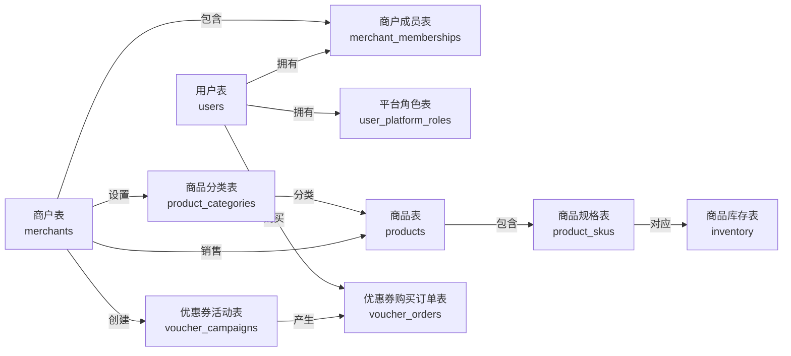

# NexusOps 第一阶段数据模型草案

> 状态：第一阶段表结构已按本草案建立在开发库和测试库中；账号注册及限购等业务规则仍待确认。范围为用户与商户权限、商户商品、优惠券秒杀正确性基线；评价、外卖、支付和 AI 的完整模型留到后续阶段。

## 1. 设计原则

- 使用 MySQL 8、InnoDB、utf8mb4；业务 ID 使用 BIGINT，自增方式为初期建议。
- 金额统一使用 DECIMAL(10,2)，不使用浮点数；时间统一保存 UTC，接口明确时区。
- 状态使用可读字符串并由服务端校验合法迁移；重要记录保留创建、更新时间。
- 交易记录保留快照，避免商品或活动修改后改变历史订单含义；库存通过条件更新和事务保证非负。
- 数据范围由服务端基于身份、成员关系和对象归属校验；外键和前端菜单不能代替授权。
- 表中的字段是首期建议，长度、索引及删除策略应在确认业务规则后通过迁移落实。

## 2. 表关系

一个用户可拥有多个商户成员关系和平台角色；一个商户可包含多个成员、分类、商品和优惠券活动。商品可以没有分类，每个商品包含一个或多个规格，每个规格对应一条库存记录。一个活动可产生多笔购买订单，每笔订单属于一个用户和一个活动。

## 3. 数据字典

以下列出首版表结构；状态和业务规则仍需完善。表中默认值为应用 ORM 写入时的默认值，并非数据库服务端默认值。“是否为空”中的“否”表示 `NOT NULL`，“是”表示允许 `NULL`。`created_at` / `updated_at` 由应用统一写入 UTC 时间；更新时间不依赖数据库自动更新。涉及外键的历史记录建议限制删除，不级联删除。

### 3.1 `users` — 用户表

保存登录身份，支持手机号加验证码，以及账号加密码两种登录方式。注册时必须设置登录账号和密码；登录账号不可修改，昵称可以修改。

| 数据库字段 | 类型 | 是否为空 | 默认值 / 约束 | 描述 |
|---|---|---|---|---|
| `id` | `BIGINT` | 否 | 主键、自增 | 用户 ID |
| `mobile` | `VARCHAR(20)` | 否 | 唯一 | 已验证的手机号，保存标准化号码 |
| `username` | `VARCHAR(64)` | 否 | 唯一 | 登录账号，注册时设置，之后不可修改 |
| `password_hash` | `VARCHAR(255)` | 否 | — | 必须设置的密码哈希，不保存明文 |
| `nickname` | `VARCHAR(80)` | 是 | 默认 NULL | 显示昵称，可由用户修改 |
| `mobile_verified_at` | `DATETIME` | 否 | 验证成功时写入 | 当前手机号完成验证的时间（UTC） |
| `status` | `VARCHAR(20)` | 否 | 默认 active | 账户状态：active 正常、disabled 停用 |
| `created_at` | `DATETIME` | 否 | 创建时写入 | 创建时间（UTC） |
| `updated_at` | `DATETIME` | 否 | 更新时写入 | 最后更新时间（UTC） |

### 3.2 `merchants` — 商户表

保存商户基本信息，作为首期数据隔离边界。

| 数据库字段 | 类型 | 是否为空 | 默认值 / 约束 | 描述 |
|---|---|---|---|---|
| `id` | `BIGINT` | 否 | 主键、自增 | 商户 ID |
| `name` | `VARCHAR(120)` | 否 | — | 商户名称 |
| `description` | `VARCHAR(500)` | 是 | 默认 NULL | 商户介绍 |
| `address` | `VARCHAR(255)` | 是 | 默认 NULL | 展示用地址 |
| `status` | `VARCHAR(20)` | 否 | 默认 pending | pending 待审核、active 营业、disabled 停用 |
| `created_at` | `DATETIME` | 否 | 创建时写入 | 创建时间（UTC） |
| `updated_at` | `DATETIME` | 否 | 更新时写入 | 最后更新时间（UTC） |

### 3.3 `merchant_memberships` — 商户成员表

记录用户在商户内的身份和状态。

| 数据库字段 | 类型 | 是否为空 | 默认值 / 约束 | 描述 |
|---|---|---|---|---|
| `id` | `BIGINT` | 否 | 主键、自增 | 成员关系 ID |
| `merchant_id` | `BIGINT` | 否 | 外键 → merchants.id；联合唯一 | 所属商户 ID |
| `user_id` | `BIGINT` | 否 | 外键 → users.id；联合唯一 | 成员用户 ID |
| `role` | `VARCHAR(20)` | 否 | — | admin 商户管理员、staff 商户员工 |
| `status` | `VARCHAR(20)` | 否 | 默认 active | active 有效、disabled 停用 |
| `created_at` | `DATETIME` | 否 | 创建时写入 | 创建时间（UTC） |
| `updated_at` | `DATETIME` | 否 | 更新时写入 | 最后更新时间（UTC） |

**唯一约束**：`(merchant_id, user_id)`。所有商户写操作仍须校验有效成员关系。

### 3.4 `user_platform_roles` — 平台角色表

记录用户的平台级角色；消费身份不需单独存储。

| 数据库字段 | 类型 | 是否为空 | 默认值 / 约束 | 描述 |
|---|---|---|---|---|
| `id` | `BIGINT` | 否 | 主键、自增 | 角色关系 ID |
| `user_id` | `BIGINT` | 否 | 外键 → users.id；联合唯一 | 用户 ID |
| `role` | `VARCHAR(30)` | 否 | 联合唯一 | 平台角色：super_admin 超级管理员、platform_admin 平台管理员 |
| `created_at` | `DATETIME` | 否 | 创建时写入 | 创建时间（UTC） |

**唯一约束**：`(user_id, role)`。平台角色均关联 `users` 中的用户，一个用户可拥有多个角色。

| 角色 | 默认职责 | 权限边界 |
|---|---|---|
| `super_admin` 超级管理员 | 管理平台管理员、角色授权和平台级安全配置；处理必要的平台治理工作 | 高风险操作仍需服务端校验和审计；敏感审批、权限提权及 RSI 发布不得自审 |
| `platform_admin` 平台管理员 | 按授权处理商户审核、平台运营和交易异常 | 默认不能授予超级管理员权限，不能绕过商户数据授权或独立审批规则 |

以上为首期角色建议；实际权限以服务端权限策略为准，不能仅凭角色名称或前端菜单判断。审批、知识管理等细粒度权限组后续单独设计。超级管理员初始账户应通过受控初始化建立，不能在源码或迁移中写入默认密码；新增或撤销超级管理员应有审计和职责分离规则。

### 3.5 `product_categories` — 商品分类表

维护商户自己的商品分类。

| 数据库字段 | 类型 | 是否为空 | 默认值 / 约束 | 描述 |
|---|---|---|---|---|
| `id` | `BIGINT` | 否 | 主键、自增 | 分类 ID |
| `merchant_id` | `BIGINT` | 否 | 外键 → merchants.id；联合唯一 | 所属商户 ID |
| `name` | `VARCHAR(120)` | 否 | 与 merchant_id 联合唯一 | 分类名称 |
| `sort_order` | `INT` | 否 | 默认 0 | 排序值，越小越靠前 |
| `status` | `VARCHAR(20)` | 否 | 默认 active | active 启用、disabled 停用 |
| `created_at` | `DATETIME` | 否 | 创建时写入 | 创建时间（UTC） |
| `updated_at` | `DATETIME` | 否 | 更新时写入 | 最后更新时间（UTC） |

### 3.6 `products` — 商品表

记录商品基本信息；价格和具体规格保存在 SKU 表。

| 数据库字段 | 类型 | 是否为空 | 默认值 / 约束 | 描述 |
|---|---|---|---|---|
| `id` | `BIGINT` | 否 | 主键、自增 | 商品 ID |
| `merchant_id` | `BIGINT` | 否 | 外键 → merchants.id | 所属商户 ID |
| `category_id` | `BIGINT` | 是 | 外键 → product_categories.id | 分类 ID；须与商品属于同一商户 |
| `name` | `VARCHAR(120)` | 否 | — | 商品名称 |
| `description` | `VARCHAR(500)` | 是 | 默认 NULL | 商品介绍 |
| `status` | `VARCHAR(20)` | 否 | 默认 inactive | active 上架、inactive 下架 |
| `created_at` | `DATETIME` | 否 | 创建时写入 | 创建时间（UTC） |
| `updated_at` | `DATETIME` | 否 | 更新时写入 | 最后更新时间（UTC） |

分类归属校验由服务端保证；商品下架优先于删除，有交易引用时不得物理删除。

### 3.7 `product_skus` — 商品规格表

保存可购买规格；无规格商品使用默认 SKU。

| 数据库字段 | 类型 | 是否为空 | 默认值 / 约束 | 描述 |
|---|---|---|---|---|
| `id` | `BIGINT` | 否 | 主键、自增 | SKU ID |
| `product_id` | `BIGINT` | 否 | 外键 → products.id | 所属商品 ID |
| `name` | `VARCHAR(120)` | 否 | — | 规格名称，如默认规格、大杯 |
| `price` | `DECIMAL(10,2)` | 否 | 非负 | 商品销售单价 |
| `status` | `VARCHAR(20)` | 否 | 默认 active | active 启用、inactive 停用 |
| `created_at` | `DATETIME` | 否 | 创建时写入 | 创建时间（UTC） |
| `updated_at` | `DATETIME` | 否 | 更新时写入 | 最后更新时间（UTC） |

### 3.8 `inventory` — 商品库存表

每个 SKU 对应一条库存记录。

| 数据库字段 | 类型 | 是否为空 | 默认值 / 约束 | 描述 |
|---|---|---|---|---|
| `sku_id` | `BIGINT` | 否 | 主键；外键 → product_skus.id | 所属 SKU ID |
| `available` | `INT` | 否 | 默认 0；非负 | 可售数量 |
| `reserved` | `INT` | 否 | 默认 0；非负 | 已预留数量 |
| `version` | `BIGINT` | 否 | 默认 0 | 并发更新版本号 |
| `updated_at` | `DATETIME` | 否 | 更新时写入 | 最后更新时间（UTC） |

库存扣减采用条件更新与事务保证非负；`version` 可用于并发控制。

### 3.9 `voucher_campaigns` — 优惠券活动表

保存活动及其库存；活动库存独立于商品库存。

| 数据库字段 | 类型 | 是否为空 | 默认值 / 约束 | 描述 |
|---|---|---|---|---|
| `id` | `BIGINT` | 否 | 主键、自增 | 活动 ID |
| `merchant_id` | `BIGINT` | 否 | 外键 → merchants.id | 所属商户 ID |
| `title` | `VARCHAR(120)` | 否 | — | 活动名称 |
| `sale_price` | `DECIMAL(10,2)` | 否 | 非负 | 活动购买价格 |
| `total_stock` | `INT` | 否 | 非负 | 活动总库存 |
| `available_stock` | `INT` | 否 | 非负；不超过 total_stock | 当前可售库存 |
| `starts_at` | `DATETIME` | 否 | 早于 ends_at | 活动开始时间（UTC） |
| `ends_at` | `DATETIME` | 否 | 晚于 starts_at | 活动结束时间（UTC） |
| `status` | `VARCHAR(20)` | 否 | 默认 draft | draft 草稿、active 上线、closed 关闭 |
| `created_at` | `DATETIME` | 否 | 创建时写入 | 创建时间（UTC） |
| `updated_at` | `DATETIME` | 否 | 更新时写入 | 最后更新时间（UTC） |

### 3.10 `voucher_orders` — 优惠券购买订单表

保存活动购买记录，不等同于后续签发的核销券。

| 数据库字段 | 类型 | 是否为空 | 默认值 / 约束 | 描述 |
|---|---|---|---|---|
| `id` | `BIGINT` | 否 | 主键、自增 | 购买订单 ID |
| `campaign_id` | `BIGINT` | 否 | 外键 → voucher_campaigns.id；联合唯一 | 活动 ID |
| `user_id` | `BIGINT` | 否 | 外键 → users.id；参与两组唯一约束 | 购买用户 ID |
| `request_id` | `VARCHAR(64)` | 否 | 与 user_id 联合唯一 | 客户端幂等请求标识 |
| `amount_snapshot` | `DECIMAL(10,2)` | 否 | 非负 | 下单时由服务端生成的价格快照 |
| `status` | `VARCHAR(20)` | 否 | 默认 created | created 已创建；后续支付、取消状态待确认 |
| `created_at` | `DATETIME` | 否 | 创建时写入 | 创建时间（UTC） |
| `updated_at` | `DATETIME` | 否 | 更新时写入 | 最后更新时间（UTC） |

**唯一约束**：`(campaign_id, user_id)` 和 `(user_id, request_id)`。前者假定取消后也不能再次购买，最终取决于待确认的限购规则。

### 3.11 验证码与账号安全（设计建议）

验证码为短期凭证，建议存入 Redis，不放入 `users` 表；按手机号和业务用途分别保存验证凭证的安全摘要、过期时间和错误尝试次数。用途至少区分注册、登录、重置密码和更换手机号。验证成功后应原子地使凭证失效，并限制发送频率和尝试次数。验证码不写入日志；必要时单独记录不含验证码的审计信息。

手机号验证成功后才创建或绑定用户；同一手机号只能绑定一个用户。注册时必须设置 `username` 和 `password_hash`；登录账号不可修改，昵称可以修改，密码使用安全密码哈希算法保存。更换手机号须验证当前用户身份及新手机号，并在事务中检查唯一性、更新手机号和验证时间。

## 4. 业务与事务约束

- 商户作为首期隔离边界，不单独建立租户表；服务端按用户、商户成员和对象归属校验权限。
- 同一 MySQL 事务内校验活动、按库存大于零条件扣减并创建购买订单；事务失败时库存扣减回滚。唯一约束阻止重复购买和重复请求。
- 核销券、模拟支付、退款与履约属于后续设计；购买订单不能代替核销券。
- 商品、SKU 和交易记录优先停用或受限删除，不能级联删除交易历史。

## 5. 关系与索引建议

- 成员关系：唯一索引 `(merchant_id, user_id)`，另按用户查询商户列表建立 `(user_id, status)` 索引。
- 商品与分类：按 `(merchant_id, status, id)` 分页查询商品；按 `(merchant_id, sort_order, id)` 查询分类。实际索引根据查询和执行计划调整。
- SKU 和库存：`product_skus.product_id` 建索引，`inventory.sku_id` 为主键及外键。
- 秒杀：购买订单建立上述两个唯一约束，并为商户/活动订单查询设计合适索引；避免把普通索引误认为并发正确性保障。
- 外键建议用于同库关键关系；删除历史业务对象采用停用或受限删除，不级联删除交易记录。

## 6. 待确认事项

1. 第一阶段是否接受**一个商户作为隔离边界**，暂不支持一个企业账号管理多个门店？
2. 已确定支持手机号 + 验证码、账号 + 密码登录；注册必须设置账号和密码，登录账号不可修改、昵称可修改。短信服务提供商后续确定。
3. 商品是否从一开始支持多个 SKU？本草案建议支持，但无规格商品自动创建默认 SKU。
4. 秒杀活动是否固定每人限购一单？如果订单取消或超时，是否允许再次购买？这直接影响唯一键和库存释放设计。
5. 第一阶段的购买订单是否包含模拟支付和超时关闭？当前计划将完整支付及履约放在第二阶段；若首期只验证抢购，订单可以先停留在创建状态。

## 7. 与现有代码的关系

当前 `backend/app/merchant/model.py` 和初始迁移已包含本文的十张业务表，并已应用到开发库和测试库。现有商品 CRUD 通过默认 SKU 兼容价格字段；多规格管理、身份认证、租户隔离及业务状态流转尚未实现。后续结构变更必须新增迁移，不得修改已应用的初始迁移。

